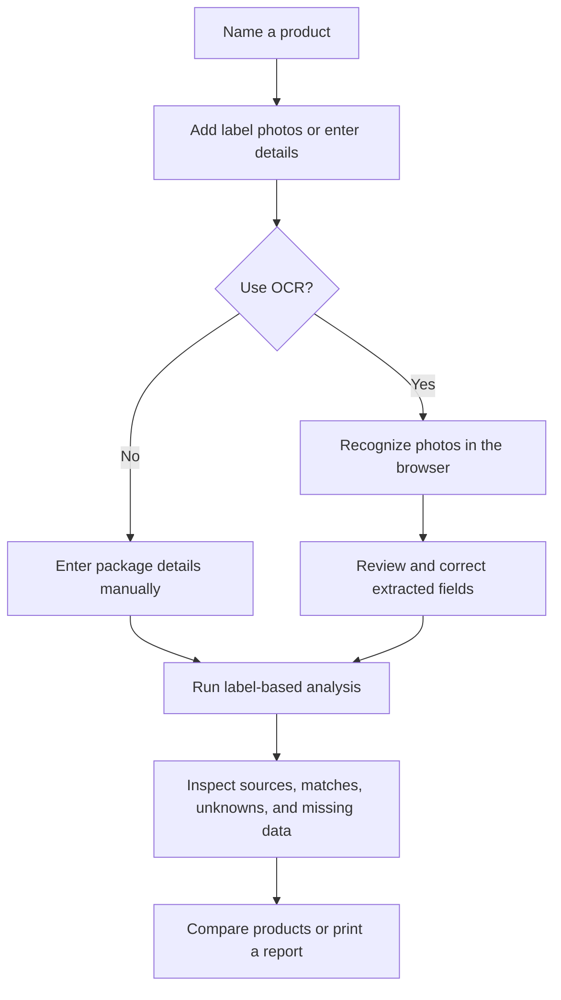
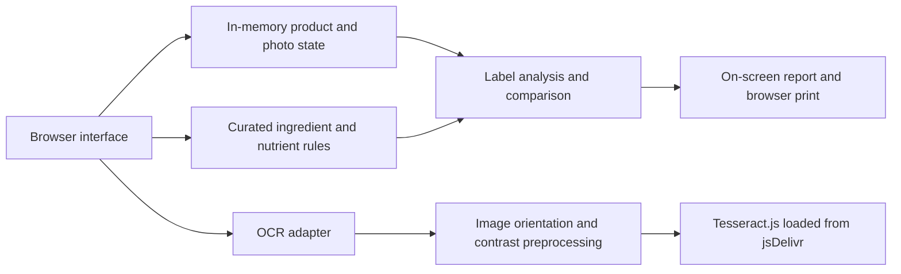

# 🥗 VeriFood

### Food labels, made clearer.

**Labelwise** is a photo-first browser app for reviewing and comparing packaged-food labels. It brings together package photos, editable ingredient and nutrition details, allergen statements, and a transparent, rule-based overview—without requiring an account or product lookup.

> 📸 Add label photos · ✍️ Review the details · 🔎 Explore the evidence · ⚖️ Compare products

## ✨ Features

- 🛍️ **Review multiple products** — name, edit, reorder, and remove products in one session.
- 📷 **Add label photos** — attach photos by label type, preview and rotate them, or drag and drop files.
- 🔤 **Read photos with OCR** — recognize label text in the browser, with English, Hindi, Spanish, French, and German language options.
- ✅ **Confirm OCR results** — inspect extracted fields, review lower-confidence words, and confirm the text before analysis.
- 🧾 **Enter label details manually** — add ingredients, “contains” and “may contain” statements, serving information, and nutrition values.
- 🧭 **See how results were formed** — inspect source and review status, ingredient matches, missing information, and analysis factors.
- 🧩 **Check personal filters** — enter terms to find possible matches in the label details you provided.
- 📊 **Compare products** — view entered values per stated serving or, when the serving is given in grams, per 100 g.
- 🖨️ **Save a report** — use the browser’s print dialog to print or save the report as a PDF.

## 🧠 How it works



OCR is an aid for entering label text, not a source of confirmed facts. Extracted information is editable, low-confidence words are called out, and review confirmation is required before analysis when OCR text was recognized.

## 🧪 Analysis and reference data

### Ingredients

Ingredient lines are matched against a **small, curated alias list** in `src/core/rules.js`. Recognized ingredients receive a rule-based description and rating; unmatched names remain unknown. The list is not a complete ingredient, additive, or toxicity database, and its results are not medical judgments.

### Nutrition

The app reads or accepts values from the package; it **does not infer missing nutrition values** from ingredients or substitute zero for unknown values. Its general overview uses comparison cues for values such as added sugar, sodium, saturated fat, fiber, and protein, together with available ingredients. It reports when the information is insufficient and shows the factors behind an assessment.

When selected, Daily Value percentages use the reference values coded in `src/core/rules.js` for the **United States FDA Daily Values (2020)** or **European Union reference intakes (1169/2011)**. These are calculations from the entered package values, not independently verified product data.

### Allergens and personal filters

The report keeps package **“contains”** and **“may contain”** statements separate. Optional personal filter terms are checked against the ingredient and allergen text entered for each product. A text match is only a flag for review; a missing statement or no match **cannot establish that a product is safe**.

### Product comparison

Compare entered nutrition values per stated serving or per 100 g. Per-100-g values are calculated only when the serving size is given as a mass in grams or kilograms. Volume-based servings and missing values are not converted or charted as if known.

## 🧱 Architecture



The app is a static browser application built with **HTML, CSS, and JavaScript ES modules**. It has no build step, framework runtime, backend, or package installation requirement. The included Node.js server serves the app locally.

## 🗂️ Project structure

| File | Responsibility |
| --- | --- |
| `index.html` | App structure, label-entry fields, product workflow, and report sections |
| `src/main.js` | In-memory app state, uploads, OCR review, rendering, product comparison, and interactions |
| `src/core/ocr.js` | Tesseract.js loading, image preprocessing, OCR, and worker cleanup |
| `src/core/rules.js` | Ingredient aliases, nutrient definitions, Daily Value references, and allergen terms |
| `src/core/analysis.js` | Data completeness, ingredient matching, nutrition overview, filters, and comparison calculations |
| `src/core/pdf.js` | Browser print entry point for the report |
| `styles.css` | Responsive layout, accessibility, and print styling |
| `serve.cjs` | Small local static server |
| `Nagardhan_Survey_Infographic.svg` | Project infographic asset |

## 🚀 Run locally

**Requirements:** [Node.js](https://nodejs.org/) and a modern browser.

1. Open a terminal in the project folder.
2. Start the local server:

   ```sh
   node serve.cjs
   ```

3. Open **http://127.0.0.1:8000** in your browser.

> 💡 Serve the app over HTTP rather than opening `index.html` directly. Browser ES modules do not work reliably from a `file:` URL.

## 🔒 Privacy and external services

- **No account, backend, product database, barcode lookup, or cloud storage.**
- Product details, dietary filters, and photos are kept in page memory for the current session. They are not submitted to an app service or saved in local storage.
- On first OCR use, the browser downloads Tesseract.js and the selected language data from jsDelivr. An internet connection is needed for that download; photo recognition runs in the browser.
- PDF export uses the browser’s local print dialog; the app does not send the report to a PDF service.
- **Start over** clears the current analysis and revokes photo previews. Closing the tab also clears the session.

## ⚠️ Scope and safety limitations

- Results depend on the package information entered or recognized and reviewed by the user. OCR can misread text; check it against the package.
- The ingredient alias list is intentionally limited. Unmatched ingredients remain unknown.
- Nutrition overview cues are app heuristics, not official product grades, individualized dietary advice, or medical guidance.
- Allergen text matching is not a complete allergen test. Always check the full, current package; for a serious allergy, contact the manufacturer when needed.
- Product labels can change. The package is the authoritative source for current product information.

---

**Labelwise** helps make package information easier to explore—not replace the label or professional advice.
